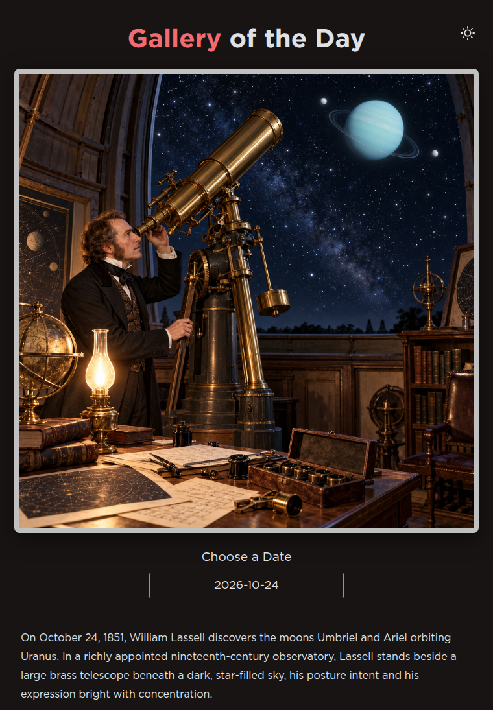

# Gallery of the Day

Gallery of the Day is a web app that shows every day a new AI-created image inspired by something that happened that day in the history.

## 🔍 Features

- 📅 Daily AI-generated images inspired by historical events
- 🖼️ Full-screen lightbox mode for immersive image viewing
- ⌨️ Keyboard navigation with arrow keys to browse between dates
- 📱 Mobile-optimized layout with adjusted UI
- 🌗 Dark (default) and light mode with a switch, in the same youcanbeapirate theme as the other apps
- 📜 Uses GPT-5.6 Luna to choose and describe a significant event from Wikipedia's "On this day" list (focusing on positive achievements), so dates and years are real
- 🎨 Creates images with GPT Image 2.5 Sunburst in high quality based on those descriptions
- 📦 Data updated daily via GitHub Actions and stored in Turso (libSQL) and Cloudflare R2

## 📸 Screenshot



## 🚀 Live App

[👉 Try it here!](https://galleryoftheday.youcanbeapirate.com/)

## Project Structure

```bash
gallery-of-the-day/
├── R/                              # Automation scripts
│   ├── create_prompt.R             # Generates historical event descriptions
│   ├── fetch_image.R               # Creates and uploads the day's image
│   ├── config.R                    # Models and prompts
│   ├── openai.R                    # OpenAI calls (retries, safety fallbacks)
│   ├── wikipedia.R                 # Real events for a date ("On this day" feed)
│   ├── r2.R                        # R2 upload with retries
│   ├── turso.R                     # Turso client (scripts and app)
│   └── backfill_date.R             # Create (or regenerate) one missing day
├── app/                            # Shiny application
│   ├── www/
│   │   ├── functions.R             # Helper functions
│   │   ├── variables.R             # Settings: colours, footer apps, R2 URL
│   │   ├── strings.R               # All user-facing text
│   │   ├── data.R                  # Loads the prompts (never throws; error states)
│   │   ├── lightbox.js             # Lightbox and arrow-key navigation
│   │   └── styles.css              # Custom styling
│   ├── global.R                    # Libraries and sourced files
│   ├── ui.R                        # User interface (bslib + Bootstrap 5)
│   ├── server.R                    # Server logic
│   └── run.R                       # App entry point
├── docs/                           # GitHub Pages site
│   └── index.html                  # Landing page
├── .github/workflows/
│   └── r_scripts_daily.yml         # Daily automation workflow
├── Dockerfile                      # Container image definition
├── docker-compose.yml              # Local development setup
├── deploy.sh                       # Google Cloud Run deployment
└── renv.lock                       # Package dependencies
```

## Tech Stack

| Component | Technology |
| --------- | ---------- |
| Language | R |
| Web Framework | Shiny + bslib |
| AI Models | GPT-5.6 Luna, GPT Image 2.5 Sunburst |
| Database | Turso (libSQL) |
| Image Storage | Cloudflare R2 |
| Automation | GitHub Actions |
| Hosting | Google Cloud Run |
| Package Management | renv |

## How It Works

### 1. Prompt Generation (`create_prompt.R`)

Uses GPT-5.6 Luna to research a positive historical event for today's date, with directive prompts that emphasize:

- **Required categories**: Scientific discoveries, cultural celebrations, artistic achievements, sports, space exploration, peaceful diplomacy, architecture, conservation
- **Strict prohibitions**: Wars, battles, violence, weapons, tragedies, political controversies
- **Visual focus**: Vivid descriptions of settings, people, atmosphere, and symbols suitable for AI image generation

This ensures diverse, uplifting content that celebrates human achievement rather than conflict.

### 2. Image Generation (`fetch_image.R`)

Sends the historical description to GPT Image 2.5 Sunburst to generate a unique high-quality artwork. The image is saved with the date in the filename for easy lookup.

### 3. Automation

GitHub Actions runs daily at 4 AM UTC:

1. Generate prompt for today
2. Create and fetch image
3. Commit new files to repository

## Local Development

### Prerequisites

- [Docker](https://docs.docker.com/get-docker/)
- R (>= 4.0) for running automation scripts outside Docker

### Setup

1. Clone the repository:

   ```bash
   git clone https://github.com/AnttiRask/gallery-of-the-day.git
   cd gallery-of-the-day
   ```

2. Copy `.env.example` to `.env` and fill in your credentials:

   ```bash
   cp .env.example .env
   ```

3. Build and run with Docker Compose:

   ```bash
   docker compose up --build
   ```

4. Open <http://localhost:8083>

The `app/` directory is volume-mounted, so code changes are reflected without rebuilding.

### Deployment

See [DEPLOY.md](DEPLOY.md) for Google Cloud Run deployment instructions.

## GitHub Actions Setup

Add these secrets to your repository:

| Secret | Description |
| ------ | ----------- |
| `OPENAI_API_KEY` | Your OpenAI API key |
| `R2_ACCESS_KEY_ID` | Cloudflare R2 access key |
| `R2_ACCOUNT_ID` | Cloudflare account ID |
| `R2_BUCKET_NAME` | R2 bucket name |
| `R2_PUBLIC_URL` | R2 public bucket URL |
| `R2_SECRET_ACCESS_KEY` | Cloudflare R2 secret key |
| `TURSO_AUTH_TOKEN` | Turso authentication token |
| `TURSO_DATABASE_URL` | Turso database URL |

## Recent Completions

- ✅ UX improvements: lightbox mode, keyboard navigation, page title, diverse events (Feb 2026)
- ✅ GPT Image 1.5 upgrade with HD quality (Feb 2026)
- ✅ GPT-5.6 Luna and GPT Image 2.5 Sunburst, structured JSON output, safety fallbacks and tests (Oct 2026)
- ✅ Google Cloud Run deployment with custom domain (Jan 2026)
- ✅ Shiny app UI makeover with bslib and dark theme (Jan 2026)
- ✅ Turso database for prompts and Cloudflare R2 for image storage (Jan 2026)

## License

MIT License - see [LICENSE](LICENSE) for details.
